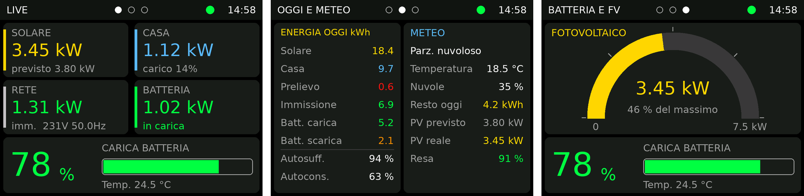
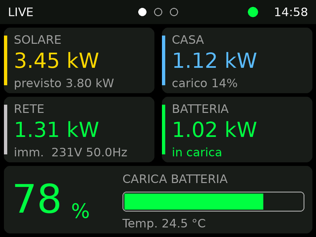
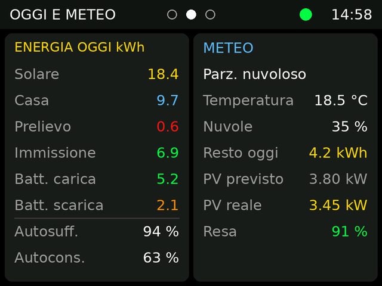
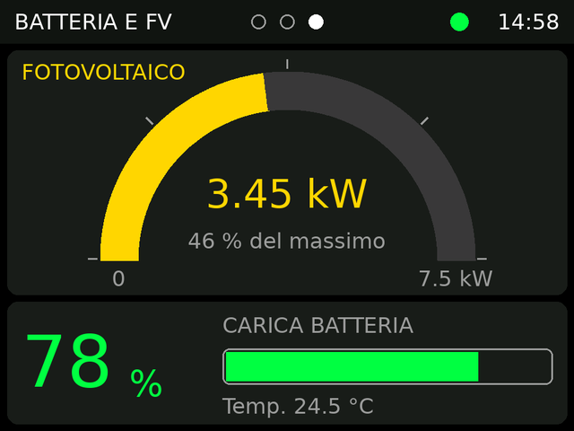
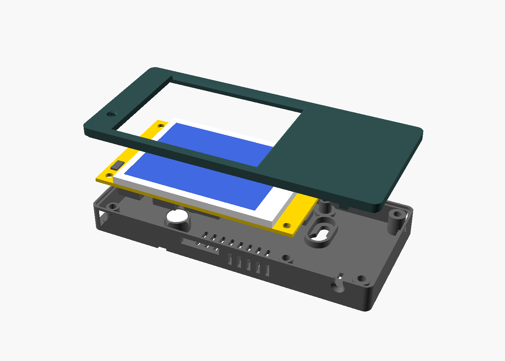
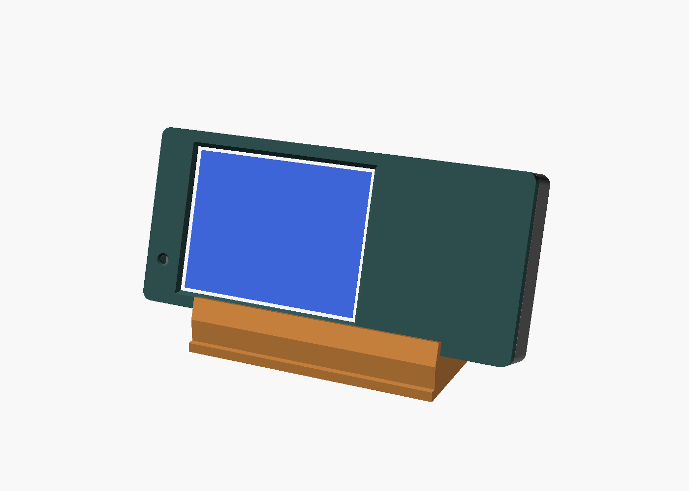
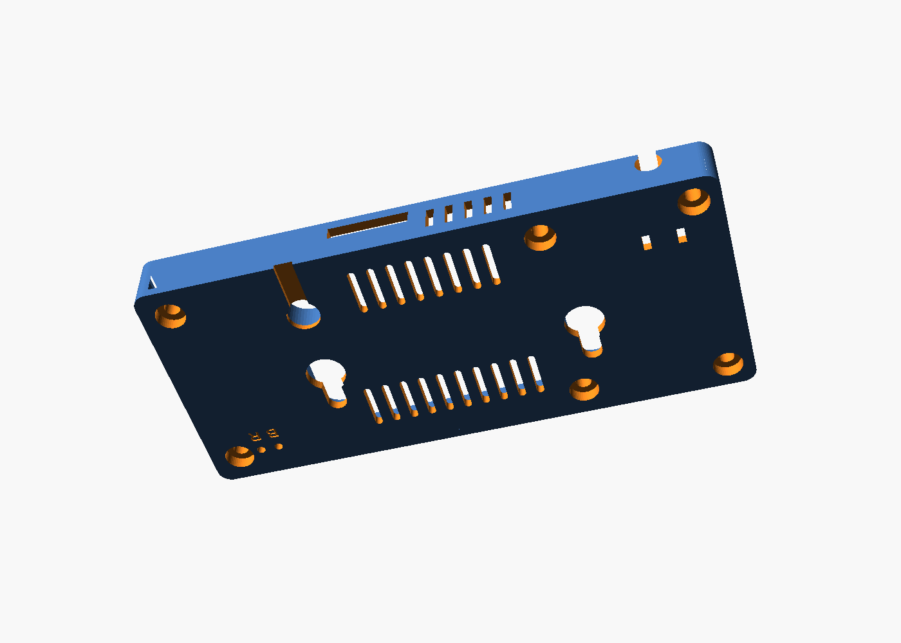
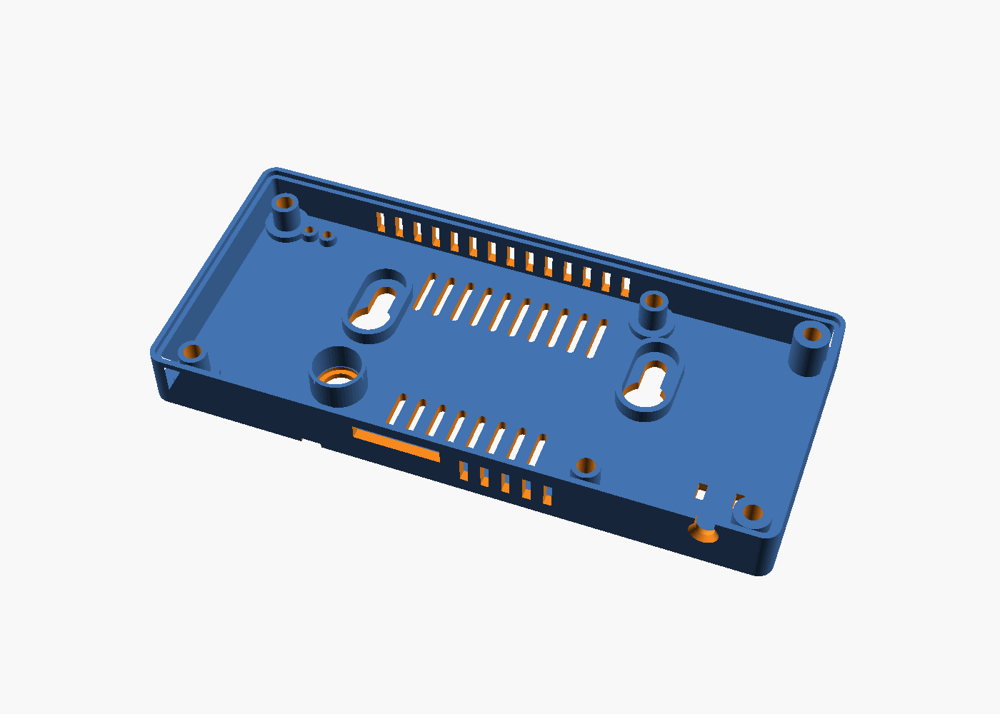
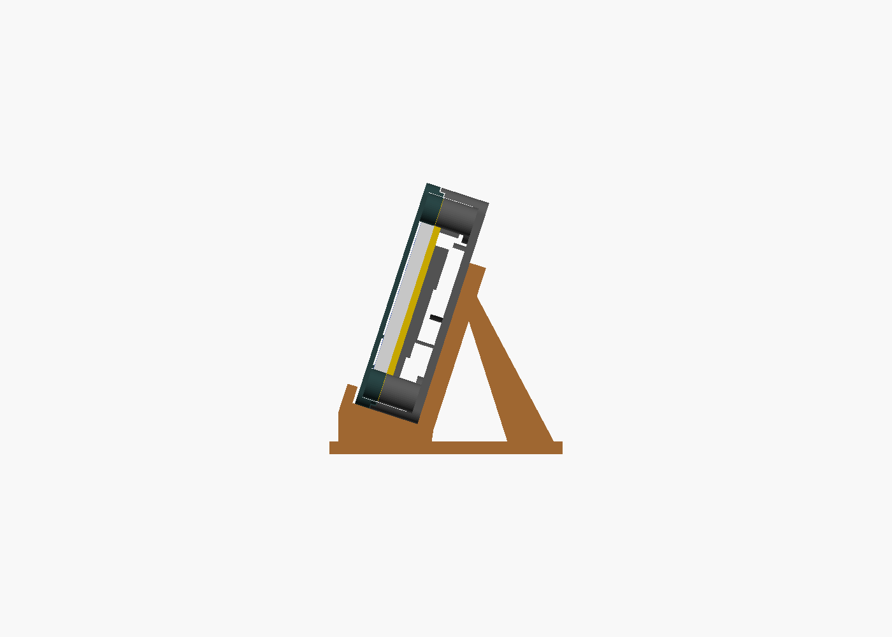

# CYD Solar Monitor

**[English](#english) · [Italiano](#italiano)**

[](https://www.paypal.com/paypalme/AlessandroLanni79)



---

<a id="english"></a>
## English

A small wall or desk display for **[Solar Assistant](https://solar-assistant.io/)**, built on the ESP32-2432S028 *"Cheap Yellow Display"* (CYD). It subscribes to Solar Assistant's MQTT broker and shows live power flows, today's energy totals, the weather forecast and the battery state across three touch-switchable pages. A parametric, support-free 3D-printable enclosure is included.

### Screens

| Live | Today & Weather | Battery & PV |
|:---:|:---:|:---:|
|  |  |  |
| PV, house load, grid, battery power + state of charge, voltage | Daily energy (kWh), self-sufficiency, self-consumption, weather, forecast vs actual PV | PV gauge (0–7.5 kW) + state of charge, voltage |

> Screens are rendered mockups with sample values; the on-device fonts look slightly different. The UI text is in Italian.

The header shows the page indicator, the time (NTP) and a status dot: **green** = OK, **orange** = Solar Assistant offline or no data for 60 s, **red** = Wi-Fi or MQTT disconnected.

### Hardware

- ESP32-2432S028 / ESP32-2432S028R (2.8" ILI9341 320×240, resistive XPT2046 touch)
- USB cable and 5 V supply
- Solar Assistant with the MQTT broker enabled (tested with one battery and two inverters, using the aggregated `total` topics)
- Optional: 3D-printed enclosure (see below)

#### Where to buy

The display used for this project is available on Amazon: **[ESP32-2432S028 Cheap Yellow Display](https://link.amazon/B07kMcnrc)**. Buying through this link costs you nothing extra and helps support the project.

<sub>This is an affiliate link: as an Amazon Associate I earn from qualifying purchases.</sub>

### MQTT topics

The firmware subscribes to:

| Topic | Used for |
|---|---|
| `solar_assistant/total/+/state` | `pv_power`, `load_power`, `grid_power`, `battery_power`, `battery_state_of_charge`, `battery_temperature`, `grid_voltage`, `grid_frequency`, `load_percentage`, daily energies (`pv_energy`, `load_energy`, `grid_energy_in/out`, `battery_energy_in/out`) |
| `solar_assistant/weather/+/state` | `cloud_cover`, `outside_temperature`, `pv_energy_remaining_today`, `pv_power_predicted`, `weather_code` |
| `solar_assistant/battery_1/voltage/state` | battery voltage (configurable) |
| `solar_assistant/status` | online/offline |

Apart from the battery voltage, the firmware only reads the `total` topics, so it works with any number of inverters and batteries.

### Build and flash (PlatformIO)

1. Open the folder in VS Code with the PlatformIO extension.
2. Copy `include/secrets.example.h` to `include/secrets.h` and fill in your Wi-Fi SSID and password, the Solar Assistant IP and, if set, the MQTT credentials. `secrets.h` is git-ignored.
3. Connect the CYD and run **Upload** for the `cyd` environment, then **Monitor** (115200 baud).

All libraries (TFT_eSPI, PubSubClient, XPT2046_Touchscreen) are fetched automatically. The display is configured through `build_flags` in `platformio.ini`, so you don't need to edit TFT_eSPI's `User_Setup.h`.

**Troubleshooting**

- *"Invalid head of packet"* while uploading: the CH340 USB-serial chip can't keep up. `upload_speed` is already set to 115200; also try a short data cable without a hub.
- White screen or inverted colours (dual-USB CYD variant): in `platformio.ini` replace `-D ILI9341_2_DRIVER=1` with `-D ST7789_DRIVER=1` and add `-D TFT_INVERSION_ON=1`.
- Pages switching on their own: phantom touches. Raise `TOUCH_MIN_Z`, or set `TOUCH_DEBUG = true` and check the readings on the serial monitor.

### Settings (top of `src/main.cpp`)

| Setting | Default | Meaning |
|---|---|---|
| `BATT_POSITIVE_IS_CHARGE` | `true` | Flip if charge/discharge is shown the wrong way round |
| `GRID_POSITIVE_IS_IMPORT` | `true` | Flip if import/export is shown the wrong way round |
| `AUTO_PAGE_MS` | `30000` | How long each page is shown during automatic rotation, in ms (`0` = touch only) |
| `IDLE_MS` | `30000` | Automatic rotation starts after this long without touches |
| `BATT_V_KEY` | `battery_1/voltage` | MQTT topic for the battery voltage (check the exact name on your system) |
| `LED_ENABLED` | `true` | Rear RGB LED "breathing": green while charging, red while discharging |
| `STALE_MS` | `60000` | Data older than this turns the status dot orange |
| `TZ_INFO` | Europe/Rome | POSIX time zone for the clock |
| `TOUCH_MIN_Z` | `600` | Minimum touch pressure |
| `GAUGE_MAX_W` | `7500` | Full scale of the PV gauge, in W |

Use `tft.setRotation(3)` instead of `1` to flip the screen by 180°.

### 3D-printable enclosure

<p>
  
  
</p>
<p>
  
  
  
</p>

Two-part case (front frame + back shell) with a separate desk stand. Outer size **120.8 × 54.8 × 15.5 mm**. No part needs supports.

| Part | STL | Notes |
|---|---|---|
| Front frame | [`cyd_front.stl`](enclosure/cyd_front.stl) | Display window with a thin lip that sits 0.4 mm above the glass and doesn't press the touch panel |
| Back shell | [`cyd_back.stl`](enclosure/cyd_back.stl) | PCB standoffs, keyhole slots for wall mounting, vents, paperclip holes for RST/BOOT, USB cable bay with strain relief |
| Desk stand | [`cyd_stand.stl`](enclosure/cyd_stand.stl) | Holds the case at 18°; two pegs fit into the keyholes |
| LED diffuser | [`cyd_diffuser.stl`](enclosure/cyd_diffuser.stl) | Optional, for the light window over the on-board RGB LED |

GitHub shows an interactive 3D preview when you open an STL link.

- **Source**: [`enclosure/cyd_enclosure.scad`](enclosure/cyd_enclosure.scad) (OpenSCAD, fully parametric)
- **Print**: PETG recommended, 0.2 mm layers, 3 perimeters, 20–25 % infill, print each part as oriented in the STL
- **Hardware**: 6 × M3×12 screws, one 2.5 mm cable tie, 2 wall screws (Ø 3.5–4 mm)

The board outline and display window come from the manufacturer's drawings. The positions of the parts on the back of the PCB (USB, buttons, LED, SD slot) come from a community CAD model. **Measure your board before printing.** Full details, print settings and the list of parameters to check are in [`enclosure/README.md`](enclosure/README.md) (Italian).

### Project structure

```
├── platformio.ini            board, libraries, display configuration
├── src/main.cpp              firmware
├── include/secrets.example.h template for Wi-Fi / MQTT credentials
├── docs/images/              screen mockups
└── enclosure/                OpenSCAD source, STLs, previews, assembly guide
```

### Support the project

If this project is useful to you, you can buy the display through the [affiliate link](#where-to-buy) above or make a small donation:

[](https://www.paypal.com/paypalme/AlessandroLanni79)

### Credits

- [Solar Assistant](https://solar-assistant.io/) for the MQTT data
- [witnessmenow/ESP32-Cheap-Yellow-Display](https://github.com/witnessmenow/ESP32-Cheap-Yellow-Display) for the board documentation and CAD references
- Libraries: [TFT_eSPI](https://github.com/Bodmer/TFT_eSPI), [PubSubClient](https://github.com/knolleary/pubsubclient), [XPT2046_Touchscreen](https://github.com/PaulStoffregen/XPT2046_Touchscreen)

This project is not affiliated with Solar Assistant.

---

<a id="italiano"></a>
## Italiano

Un piccolo display da parete o da tavolo per **[Solar Assistant](https://solar-assistant.io/)**, basato sull'ESP32-2432S028 *"Cheap Yellow Display"* (CYD). Si collega al broker MQTT di Solar Assistant e mostra, su tre pagine che si cambiano toccando lo schermo, i flussi di potenza in tempo reale, l'energia del giorno, le previsioni meteo e lo stato della batteria. Include una scatola stampabile in 3D, parametrica e senza supporti.

### Schermate

| Live | Oggi e meteo | Batteria e FV |
|:---:|:---:|:---:|
|  |  |  |
| Potenza di FV, casa, rete e batteria + stato di carica e tensione | Energia del giorno (kWh), autosufficienza, autoconsumo, meteo, FV previsto e reale | Gauge del FV (0–7,5 kW) + stato di carica e tensione |

> Le schermate sono simulazioni con valori di esempio; sul display i font sono un po' diversi.

Nell'intestazione ci sono l'indicatore di pagina, l'ora (via NTP) e un pallino di stato: **verde** = tutto ok, **arancione** = Solar Assistant offline o nessun dato da 60 s, **rosso** = WiFi o MQTT disconnessi.

### Hardware

- ESP32-2432S028 / ESP32-2432S028R (ILI9341 da 2,8" 320×240, touch resistivo XPT2046)
- Cavo USB e alimentatore 5 V
- Solar Assistant con il broker MQTT attivo (provato con una batteria e due inverter, usando i topic aggregati `total`)
- Opzionale: scatola stampata in 3D (vedi sotto)

#### Dove acquistarlo

Il display usato in questo progetto si trova su Amazon: **[ESP32-2432S028 Cheap Yellow Display](https://link.amazon/B07kMcnrc)**. Acquistandolo da questo link non paghi nulla in più e sostieni il progetto.

<sub>Link di affiliazione: in qualità di Affiliato Amazon ricevo un guadagno dagli acquisti idonei.</sub>

### Topic MQTT

Il firmware si iscrive a:

| Topic | A cosa serve |
|---|---|
| `solar_assistant/total/+/state` | `pv_power`, `load_power`, `grid_power`, `battery_power`, `battery_state_of_charge`, `battery_temperature`, `grid_voltage`, `grid_frequency`, `load_percentage`, energie giornaliere (`pv_energy`, `load_energy`, `grid_energy_in/out`, `battery_energy_in/out`) |
| `solar_assistant/weather/+/state` | `cloud_cover`, `outside_temperature`, `pv_energy_remaining_today`, `pv_power_predicted`, `weather_code` |
| `solar_assistant/battery_1/voltage/state` | tensione batteria (configurabile) |
| `solar_assistant/status` | online/offline |

A parte la tensione della batteria, il firmware legge solo i topic `total`, quindi funziona con qualsiasi numero di inverter e batterie.

### Compilazione e caricamento (PlatformIO)

1. Apri la cartella in VS Code con l'estensione PlatformIO.
2. Copia `include/secrets.example.h` in `include/secrets.h` e inserisci SSID e password del WiFi, l'IP di Solar Assistant ed eventuali credenziali MQTT. `secrets.h` è escluso da git.
3. Collega il CYD, lancia **Upload** sull'ambiente `cyd` e poi **Monitor** (115200 baud).

Le librerie (TFT_eSPI, PubSubClient, XPT2046_Touchscreen) vengono scaricate in automatico. Il display è configurato tramite i `build_flags` di `platformio.ini`, quindi non serve modificare il `User_Setup.h` di TFT_eSPI.

**Problemi comuni**

- *"Invalid head of packet"* durante il caricamento: il chip USB-seriale CH340 non regge la velocità. `upload_speed` è già a 115200; prova anche un cavo dati corto, senza hub.
- Schermo bianco o colori invertiti (variante del CYD con due USB): in `platformio.ini` sostituisci `-D ILI9341_2_DRIVER=1` con `-D ST7789_DRIVER=1` e aggiungi `-D TFT_INVERSION_ON=1`.
- Le pagine cambiano da sole: sono tocchi fantasma. Alza `TOUCH_MIN_Z`, oppure imposta `TOUCH_DEBUG = true` e guarda le letture sul monitor seriale.

### Impostazioni (in cima a `src/main.cpp`)

| Impostazione | Predefinito | Significato |
|---|---|---|
| `BATT_POSITIVE_IS_CHARGE` | `true` | Inverti se carica e scarica risultano al contrario |
| `GRID_POSITIVE_IS_IMPORT` | `true` | Inverti se prelievo e immissione risultano al contrario |
| `AUTO_PAGE_MS` | `30000` | Quanto resta ogni pagina nello scorrimento automatico, in ms (`0` = solo touch) |
| `IDLE_MS` | `30000` | Lo scorrimento automatico parte dopo questo tempo senza tocchi |
| `BATT_V_KEY` | `battery_1/voltage` | Topic MQTT della tensione batteria (verifica il nome esatto sul tuo impianto) |
| `LED_ENABLED` | `true` | "Respiro" del LED RGB sul retro: verde in carica, rosso in scarica |
| `STALE_MS` | `60000` | Oltre questo tempo senza dati il pallino diventa arancione |
| `TZ_INFO` | Europe/Rome | Fuso orario POSIX per l'orologio |
| `TOUCH_MIN_Z` | `600` | Pressione minima per un tocco valido |
| `GAUGE_MAX_W` | `7500` | Fondo scala del gauge FV, in W |

Per ruotare lo schermo di 180° usa `tft.setRotation(3)` al posto di `1`.

### Scatola stampabile in 3D

<p>
  
  
</p>

Scatola in due parti (cornice frontale + guscio posteriore) con un supporto da tavolo separato. Ingombro **120,8 × 54,8 × 15,5 mm**. Nessuna parte richiede supporti.

| Parte | STL | Note |
|---|---|---|
| Cornice | [`cyd_front.stl`](enclosure/cyd_front.stl) | Finestra sul display con un bordo sottile che resta 0,4 mm sopra il vetro e non preme sul touch |
| Guscio posteriore | [`cyd_back.stl`](enclosure/cyd_back.stl) | Colonnine per la scheda, asole per il muro, feritoie, fori per RST/BOOT, vano cavo USB con fermacavo |
| Supporto da tavolo | [`cyd_stand.stl`](enclosure/cyd_stand.stl) | Tiene la scatola inclinata di 18°; due perni entrano nelle asole |
| Diffusore LED | [`cyd_diffuser.stl`](enclosure/cyd_diffuser.stl) | Opzionale, per la finestrella sopra il LED RGB della scheda |

Aprendo un link STL, GitHub mostra un'anteprima 3D interattiva.

- **Sorgente**: [`enclosure/cyd_enclosure.scad`](enclosure/cyd_enclosure.scad) (OpenSCAD, completamente parametrico)
- **Stampa**: PETG consigliato, strato 0,2 mm, 3 perimetri, riempimento 20–25 %, ogni parte nell'orientamento dell'STL
- **Minuteria**: 6 viti M3×12, una fascetta da 2,5 mm, 2 viti da muro (Ø 3,5–4 mm)

Il profilo della scheda e la finestra del display vengono dai disegni del produttore. Le posizioni dei componenti sul retro della scheda (USB, pulsanti, LED, slot SD) vengono da un modello CAD della community. **Misura la tua scheda prima di stampare.** Impostazioni di stampa, montaggio e l'elenco delle quote da verificare sono in [`enclosure/README.md`](enclosure/README.md).

### Struttura del progetto

```
├── platformio.ini            scheda, librerie, configurazione display
├── src/main.cpp              firmware
├── include/secrets.example.h modello per credenziali WiFi / MQTT
├── docs/images/              simulazioni delle schermate
└── enclosure/                sorgente OpenSCAD, STL, anteprime, guida di montaggio
```

### Sostieni il progetto

Se il progetto ti è utile, puoi acquistare il display dal [link di affiliazione](#dove-acquistarlo) qui sopra oppure fare una piccola donazione:

[](https://www.paypal.com/paypalme/AlessandroLanni79)

### Riconoscimenti

- [Solar Assistant](https://solar-assistant.io/) per i dati MQTT
- [witnessmenow/ESP32-Cheap-Yellow-Display](https://github.com/witnessmenow/ESP32-Cheap-Yellow-Display) per la documentazione della scheda e i riferimenti CAD
- Librerie: [TFT_eSPI](https://github.com/Bodmer/TFT_eSPI), [PubSubClient](https://github.com/knolleary/pubsubclient), [XPT2046_Touchscreen](https://github.com/PaulStoffregen/XPT2046_Touchscreen)

Questo progetto non è affiliato a Solar Assistant.
